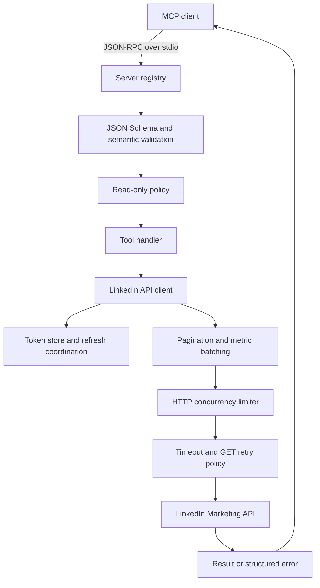

# LinkedIn Ads MCP Toolkit

A configurable Model Context Protocol server for querying LinkedIn advertising data, generating performance reports, and managing campaigns from an MCP-compatible client.

[](CHANGELOG.md)
[](https://github.com/adops-tool/linkedin-ads-mcp-toolkit/actions/workflows/ci.yml)
[](LICENSE)
[](https://nodejs.org/)
[](tsconfig.json)
[](https://modelcontextprotocol.io/)

[Repository](https://github.com/adops-tool/linkedin-ads-mcp-toolkit) · [Issue Tracker](https://github.com/adops-tool/linkedin-ads-mcp-toolkit/issues) · [CI Runs](https://github.com/adops-tool/linkedin-ads-mcp-toolkit/actions)

Use natural-language requests such as “Compare last month's campaigns” or “Show lead acquisition costs,” while the client translates those requests into typed MCP tool calls. The server also provides standalone HTML dashboard and console report generators.

> [!IMPORTANT]
> This project requires your own LinkedIn developer application, approved API products, and access to the advertising accounts you query. It cannot grant permissions that your LinkedIn account or developer application does not have.

## Table of Contents

1. [Features](#features)
2. [Tech Stack & Architecture](#tech-stack--architecture)
3. [Getting Started](#getting-started)
4. [Testing](#testing)
5. [Deployment](#deployment)
6. [Usage](#usage)
7. [Configuration](#configuration)
8. [License](#license)
9. [Contacts & Community Support](#support-the-project)

## Features

- **28 MCP tools:** account discovery, performance analysis, demographic reporting, conversion tracking, lead generation, ad library searches, campaign administration, image uploads, custom analytics, and local diagnostics.
- **Client-independent integration:** standard MCP over stdin/stdout; compatible with clients that support locally launched stdio servers.
- **Account discovery:** enumerate accessible accounts, inspect account settings, and optionally include test accounts.
- **Campaign and creative reports:** impressions, clicks, landing-page clicks, spend, CTR, CPC, CPM, engagements, conversion metrics, video metrics, reach estimates, and supported dwell-time and penetration metrics.
- **Audience reporting:** job function, seniority, industry, company size, job title, company, country, and region pivots, subject to API permissions and reporting availability.
- **Conversion and lead analysis:** tracking definitions, attribution breakdowns, form submissions, qualified leads, and acquisition costs.
- **Comparative reporting:** time-period, campaign-set, and campaign-group comparisons with absolute and percentage changes.
- **Daily trends:** date-level records, aggregate statistics, peak/lowest days, and UTC weekday summaries.
- **Custom analytics:** select raw metrics, reporting dimensions, entity filters, and daily/monthly/yearly/all-time granularity.
- **Metric batching:** large selections are split into bounded requests and merged by reporting dimensions; mismatched dimensions produce an explicit error.
- **Complete collection traversal:** cursor pagination for account-structure searches and offset/link pagination for supported collection endpoints.
- **Pagination safeguards:** repeated cursors, untrusted pagination URLs, and configured page limits fail explicitly instead of silently returning incomplete data.
- **Campaign administration:** create groups and campaigns, update budgets and targeting, manage creative statuses, create inline ads, and delete supported entities.
- **Account-aware budgets:** omitted budget currencies use the advertising account's currency; conflicting currencies are rejected before writes.
- **Optional read-only operation:** hide write tools from discovery and reject mutation requests at both MCP and API boundaries.
- **Validated inputs:** JSON Schema validation plus calendar-date, identifier, monetary-value, URL, range, and upload-path checks.
- **Resilient reads:** per-attempt timeouts, bounded concurrency, selected transient-error retries, exponential backoff, jitter for HTTP retries, and `Retry-After` support.
- **Safe mutation behavior:** write requests are issued once; ambiguous network failures explain that remote state should be checked before another attempt.
- **Concurrent GET deduplication:** identical reads in flight share one request without retaining completed account data in a response cache.
- **OAuth lifecycle management:** loopback callback server, random state validation, configurable scopes, local token storage, refresh handling, forced login, status, and logout.
- **Reliable token persistence:** validated token payloads, atomic file replacement, restricted creation modes where supported, and serialized writes within a process.
- **Standalone reporting:** configurable HTML dashboard and a console performance summary.
- **Dashboard content handling:** escaped text/attributes, protected embedded JSON, and HTTP(S)-only links and image URLs.
- **Operational tooling:** strict TypeScript compilation, automated regression tests, MCP protocol integration tests, cross-platform CI configuration, and a non-root Docker image definition.

> [!NOTE]
> Metric availability depends on the selected API version, pivot, date range, app products, and account permissions. An empty successful result can mean there was no eligible activity; a failed API request is reported separately.

## Tech Stack & Architecture

| Component | Technology | Responsibility |
| --- | --- | --- |
| Runtime | Node.js 22+ | ESM execution, native HTTP/fetch, cancellation, filesystem, test runner |
| Language | TypeScript with strict checking | Source types and compile-time validation |
| MCP | `@modelcontextprotocol/sdk` | Protocol handling and stdio transport |
| Input validation | Ajv | Compile and apply tool JSON Schemas |
| Configuration | Environment variables and `dotenv` | CLI configuration and `.env` loading |
| OAuth callback | Native `node:http` | Temporary loopback authorization listener |
| Browser launch | `open` | Optional platform-independent authorization/dashboard opening |
| Dashboard charts | Chart.js | Browser-side charts loaded from a versioned CDN URL |
| Tests | `node:test`, `node:assert` | Regression, HTTP, OAuth, and MCP integration coverage |

### Project Structure

<details>
<summary>Expand the source tree</summary>

```text
.
├── .github/workflows/ci.yml       # Linux/Windows, Node.js 22/24 checks
├── .dockerignore
├── .env.example                  # Documented configuration template
├── .gitignore
├── CHANGELOG.md
├── Dockerfile                    # Multi-stage build; non-root runtime
├── LICENSE
├── README.md
├── package.json
├── package-lock.json
├── tsconfig.json
├── src/
│   ├── index.ts                  # Process entry point and stdio lifecycle
│   ├── server.ts                 # Tool registry, validation, dispatch
│   ├── auth-cli.ts               # Login/status/logout CLI
│   ├── auth/
│   │   ├── oauth.ts              # Authorization and callback exchange
│   │   └── token-store.ts        # Atomic persistence and token refresh
│   ├── lib/
│   │   ├── config.ts             # Validated transport configuration
│   │   ├── dates.ts              # Calendar and range validation
│   │   ├── html.ts               # HTML, script JSON, and URL helpers
│   │   ├── http.ts               # Timeouts, retries, concurrency, errors
│   │   ├── linkedin-api.ts       # LinkedIn endpoints and pagination
│   │   ├── types.ts              # API and tool interfaces
│   │   └── validation.ts         # Schema and semantic input checks
│   ├── tools/
│   │   ├── accounts.ts
│   │   ├── ad-library.ts
│   │   ├── analytics.ts
│   │   ├── campaign-management.ts
│   │   ├── conversions.ts
│   │   ├── demographics.ts
│   │   └── performance.ts
│   └── scripts/
│       ├── generate-dashboard.ts
│       └── list_performance.ts
├── test/
│   ├── auth.test.mjs
│   ├── core.test.mjs
│   └── mcp.test.mjs
└── linkedin-ads-mcp-main/         # Compatibility launcher for the former nested copy
```

`dist/` is generated by the build and is not source-controlled. The root project is the canonical source tree; the legacy nested launcher forwards commands to it.

</details>

### Key Design Decisions

- **Stdio as the transport:** the MCP client owns the server process. Protocol messages use stdout; operational server messages use stderr.
- **Separate startup and server construction:** `createMcpServer()` can be exercised using in-memory transports without starting a subprocess or touching LinkedIn.
- **Validation before dispatch:** malformed tool arguments fail before API handlers execute. Unknown top-level arguments are rejected to catch misspelled configuration.
- **One shared API client per server:** tool calls use the same concurrency limiter and in-flight read map.
- **No automatic write retries:** an upstream operation may have committed even if its response was lost. The caller must inspect the account before repeating that action.
- **No completed-response cache:** subsequent reads obtain fresh data; only overlapping identical reads are coalesced.
- **Bounded collection traversal:** retrieving a large account cannot loop indefinitely on a repeated cursor.
- **Local OAuth persistence:** tokens stay on the machine running the server. The application does not provide a hosted token service.

<details>
<summary>Request flow and error handling</summary>



Collection and entity authorization failures propagate to the caller. A missing entity is represented as absent only where the relevant lookup receives HTTP 404. Tool errors use an MCP result with `isError: true`; API errors may include HTTP `status` and a LinkedIn `requestId` when available.

`get_server_status` reads local metadata only. It does not refresh tokens or verify network access, granted scopes, app approval, or advertising-account membership.

</details>

## Getting Started

### Prerequisites

1. **Node.js 22 or newer** and npm. Verify with `node --version` and `npm --version`.
2. **A LinkedIn account** that has access to the advertising account you want to query.
3. **A LinkedIn developer application** associated with the appropriate organization/company page.
4. **Approved API products and OAuth scopes** for the operations you intend to use.
5. **An MCP client with local stdio support** to invoke the tools interactively.
6. **Git**, if cloning rather than using an extracted source archive.

Docker is optional. Python, a database, and a separate web server are not required.

### 1. Download and Build

Clone the repository and install the locked dependencies:

```sh
git clone https://github.com/adops-tool/linkedin-ads-mcp-toolkit.git
cd linkedin-ads-mcp-toolkit
npm ci --ignore-scripts
npm run build
```

If you already extracted the repository, open a terminal in the folder containing `package.json` and run the final two commands there.

### 2. Create Your Environment File

macOS / Linux:

```sh
cp .env.example .env
```

Windows PowerShell:

```powershell
Copy-Item .env.example .env
```

Edit `.env` locally:

```dotenv
LINKEDIN_CLIENT_ID=replace_with_your_client_id
LINKEDIN_CLIENT_SECRET=replace_with_your_client_secret
LINKEDIN_REDIRECT_URI=http://localhost:3000/callback

# Optional: expose reporting tools only.
LINKEDIN_READ_ONLY=true
```

> [!CAUTION]
> `.env`, token files, generated dashboards, and exported reports may contain credentials or confidential advertising data. Keep them out of public repositories and shared attachments. The supplied ignore rules cover the default paths; custom output paths require your own ignore rules.

### 3. Configure the LinkedIn Developer Application

1. Open the [LinkedIn Developer Portal](https://www.linkedin.com/developers/apps).
2. Create or select your application and associate the required company page.
3. In **Products**, request the advertising/reporting API access required by your use case. Approval and available products depend on LinkedIn's review process.
4. In **Auth**, add the exact redirect URI: `http://localhost:3000/callback`.
5. Copy the application's **Client ID** and **Client Secret** into `.env`.
6. Check the scopes granted to the application. The default requested scopes are:

| Scope | Used for |
| --- | --- |
| `rw_ads` | Advertising-account and campaign management |
| `r_ads_reporting` | Advertising analytics and reporting |
| `r_organization_social` | Reading organization post content for creative enrichment |
| `w_organization_social` | Organization-owned content/image workflows where required |

If your application has a different approved scope set, configure `LINKEDIN_SCOPES` as a space-separated list. Reporting-only installations may request approved read scopes such as `r_ads r_ads_reporting`; content enrichment may require additional permissions.

> [!IMPORTANT]
> `LINKEDIN_READ_ONLY=true` restricts this server's operations. It does not change OAuth grants. Set `LINKEDIN_SCOPES` separately when you want a different authorization request.

### 4. Authenticate

```sh
npm run auth
```

The CLI starts a temporary loopback listener, prints the LinkedIn authorization URL, and attempts to open your browser. Sign in and authorize the application. A successful callback stores tokens in:

```text
~/.linkedin-ads-mcp/tokens.json
```

On Windows, `~` denotes your user profile directory. Set `TOKEN_STORAGE_PATH` to choose a different absolute path.

Verify the saved state:

```sh
npm run auth -- --status
```

Access-token validity comes from LinkedIn's token response. Automatic refresh is available only when a usable refresh token was issued and client credentials are available to the server process. When no refresh token is available, authenticate again after expiration.

### 5. Connect an MCP Client

Add a server entry using your client's local MCP configuration. Merge it with existing servers:

```json
{
  "mcpServers": {
    "linkedin-ads": {
      "command": "node",
      "args": ["/absolute/path/to/linkedin-ads-mcp-toolkit/dist/index.js"],
      "env": {
        "LINKEDIN_CLIENT_ID": "your_client_id",
        "LINKEDIN_CLIENT_SECRET": "your_client_secret",
        "TOKEN_STORAGE_PATH": "/absolute/path/to/tokens.json",
        "LINKEDIN_READ_ONLY": "true"
      }
    }
  }
}
```

Use an actual absolute path. On Windows, JSON paths can use forward slashes, for example `C:/Projects/linkedin-ads-mcp-toolkit/dist/index.js`, or escaped backslashes. If the desktop client cannot resolve `node`, provide the full path to `node.exe`.

Restart or reconnect the client, then request:

```text
Show the LinkedIn Ads server status.
List my LinkedIn advertising accounts.
```

> [!NOTE]
> `.env` is loaded relative to the process working directory. Desktop MCP clients may launch the process from another directory. Supplying environment variables directly in the client configuration and an absolute `TOKEN_STORAGE_PATH` makes the runtime configuration explicit.

<details>
<summary>Optional client-specific locations, manual authorization, and setup troubleshooting</summary>

For clients using a `mcpServers` JSON configuration, the preceding example supplies the process definition. Some clients use a different wrapper or configuration format; retain the command, absolute argument path, and environment values.

Common desktop configuration locations include:

- macOS: `~/Library/Application Support/Claude/claude_desktop_config.json`
- Windows: `%APPDATA%/Claude/claude_desktop_config.json`

The project does not edit these files automatically.

For manual browser opening, set `LINKEDIN_AUTH_NO_BROWSER=true` before `npm run auth`, then open the printed URL yourself. Authorization must return to the machine running the callback listener; a remote host's `localhost` is a different machine.

| Symptom | Resolution |
| --- | --- |
| `npm` or `node` is not found | Install Node.js, reopen the terminal, and verify PATH. Desktop applications may need a restart or an absolute executable path. |
| `dist/auth-cli.js` or `dist/index.js` is missing | Run `npm run build` in the project root. |
| Missing OAuth credentials | Replace placeholders in `.env`, or pass the environment variables through the MCP client configuration. |
| Callback `EADDRINUSE` | Choose a free loopback port in `LINKEDIN_REDIRECT_URI`, and register that exact URI in the developer portal. |
| Redirect URI mismatch | Match scheme, hostname, port, and path exactly between the application and `.env`. |
| Invalid OAuth scope | Request only scopes approved for your developer application. |
| Authorization times out | Run the command again, open the new URL, and complete consent before the configured timeout. |
| No advertising accounts | Check account membership, selected LinkedIn identity, app access, and whether the account is a test account. Try `includeTest: true` where appropriate. |
| HTTP 401 | Inspect local expiration and reauthenticate with `npm run auth -- --force`. |
| HTTP 403 | Check API product approval, granted scopes, and advertising-account roles. Repeating the same request does not add permissions. |
| HTTP 429 | Reduce concurrent requests or report scope. Reads honor a valid bounded `Retry-After`; long server delays return an error for the caller to retry later. |
| JSON-RPC parsing error | Launch `dist/index.js` directly. Avoid shell wrappers that print banners to stdout. |
| Token save fails | Check directory permissions and available disk space; use a writable absolute token directory. |
| API version is rejected | Choose a supported `LINKEDIN_API_VERSION`, validate endpoint compatibility, and rebuild/restart as needed. |
| Dashboard charts do not render | Check browser developer tools and network access to the versioned Chart.js CDN. |

</details>

## Testing

Run the complete static-check and test gate:

```sh
npm run check
```

Individual commands:

| Command | Purpose |
| --- | --- |
| `npm run typecheck` | Strict TypeScript validation without emitting files |
| `npm test` | Build and execute all test files |
| `npm run test:unit` | Build and run core/API/OAuth regression tests |
| `npm run test:integration` | Build and test MCP discovery, dispatch, read-only behavior, and a real stdio subprocess |
| `npm audit` | Query the npm advisory database for the installed dependency tree |
| `npm run build` | Compile runtime JavaScript, declarations, and source maps |

The test suite uses mocked LinkedIn responses and temporary local HTTP servers. It does not require LinkedIn credentials, spend advertising budget, or call the real LinkedIn API. OAuth tests exercise state validation, callback paths, port conflicts, token exchange, and timeout cleanup locally.

The repository uses TypeScript checking as its static-analysis gate; no separate ESLint configuration is included.

Report reproducible problems through the [GitHub issue tracker](https://github.com/adops-tool/linkedin-ads-mcp-toolkit/issues). Include your Node.js version, operating system, failing command or tool name, and a sanitized error message.

<details>
<summary>Coverage reports and live verification boundaries</summary>

To request native Node.js coverage output after building:

```sh
npm run build
node --test --experimental-test-coverage test/*.test.mjs
```

Covered scenarios include permanent/transient HTTP errors, failed writes, timeouts, concurrency limits, request coalescing, pagination, metric merging, token corruption and refresh races, HTML escaping, input validation, account currencies, and reporting edge cases.

Local and mocked tests verify application behavior. They do not establish that your developer application has the necessary LinkedIn access or that every endpoint is available in your account. After deployment, first use `get_server_status`, `list_ad_accounts`, and a small reporting request against an account you control. Test write workflows against a suitable test account before enabling them for production accounts.

</details>

## Deployment

### Local Production Process

Build and verify before removing development dependencies:

```sh
npm ci --ignore-scripts
npm run check
npm prune --omit=dev --ignore-scripts
node dist/index.js
```

Normally your MCP client launches the final command. An idle terminal process is expected: the stdio server waits for MCP messages and does not expose a browser interface or network health endpoint.

Use a dedicated writable token directory, explicit environment variables, and the operating-system identity intended to own the credentials. Start with `LINKEDIN_READ_ONLY=true` when deploying reporting workflows. The process handles `SIGINT` and `SIGTERM` by closing its MCP transport.

### Continuous Integration

The included [CI workflow](.github/workflows/ci.yml) installs the committed lockfile, runs type checking and tests, and checks high-or-critical npm advisories on Linux and Windows with Node.js 22 and 24. Configure it in your repository's Actions environment; adding the workflow does not mean a hosted run has already passed.

### Container Deployment

```sh
docker build -t linkedin-ads-mcp-toolkit:local .
```

Authenticate on the host first, then mount the token **directory** into the non-root container:

```sh
docker run --rm -i \
  --env-file .env \
  -e LINKEDIN_READ_ONLY=true \
  -e TOKEN_STORAGE_PATH=/home/node/.linkedin-ads-mcp/tokens.json \
  --mount type=bind,source=/absolute/path/to/.linkedin-ads-mcp,target=/home/node/.linkedin-ads-mcp \
  linkedin-ads-mcp-toolkit:local
```

The directory must be writable by the container's `node` user when token refresh is required. The runtime image defaults to read-only tool operation; explicitly set `LINKEDIN_READ_ONLY=false` only when writes are part of your intended workflow.

<details>
<summary>Container and process-management details</summary>

- Keep stdin attached with `-i`; allocating a terminal with `-t` is unnecessary for MCP stdio.
- No port mapping is required for the MCP server. Authenticate on the host; the temporary OAuth callback is a separate local CLI workflow.
- Mounting a single `tokens.json` file can interfere with atomic rename. Mount the containing directory instead.
- Do not bake `.env` or token files into an image. The supplied `.dockerignore` excludes the default sensitive paths.
- Relative file uploads resolve inside the container; MCP uploads require absolute paths that exist in that runtime.
- After pruning development dependencies, run the compiled server directly. Development/build scripts require the TypeScript compiler.
- Prefer one active process per token file, or use separate `TOKEN_STORAGE_PATH` values. Refresh coordination and write serialization are process-local.
- The Dockerfile is an optional deployment definition. Verify the build and mount permissions in your Docker environment before use.

</details>

## Usage

### Basic Workflow

1. Ask the client to run `get_server_status` to inspect local settings and token expiration.
2. Run `list_ad_accounts` and select an account ID.
3. Start with a short reporting range.
4. Request comparisons or more detailed pivots as needed.

Example MCP tool-call parameters:

```json
{
  "name": "get_campaign_performance",
  "arguments": {
    "accountId": "123456789",
    "startDate": "2026-09-01",
    "endDate": "2026-09-30",
    "timeGranularity": "ALL"
  }
}
```

These are the `params` supplied to an MCP `tools/call` request; your client provides the JSON-RPC envelope and request identifier.

Natural-language examples:

```text
Show campaign performance for the last 30 days.
Which job functions have the highest click-through rate?
Compare September with August for account 123456789.
Show daily conversion trends for the previous two weeks.
Which creatives have the best video completion rate?
List draft and paused campaigns, including those without impressions.
Search the public ad library for a competitor's advertisements.
```

### Available Tools

<details>
<summary>Expand the complete 28-tool reference</summary>

| Tool | Operation | Purpose |
| --- | --- | --- |
| `get_server_status` | Local | Configuration, local token expiration, tool count; no network request |
| `list_ad_accounts` | Read | Accessible accounts; status/type/test filtering |
| `get_account_details` | Read | Account currency, settings, status, and notifications |
| `get_campaign_performance` | Read | Campaign KPIs and optional time buckets |
| `get_creative_performance` | Read | Creative KPIs, engagement breakdown, and optional video metrics |
| `get_campaign_groups` | Read | Campaign groups, campaign counts, optional performance when a start date is supplied |
| `get_audience_demographics` | Read | Performance by supported demographic pivot |
| `get_audience_reach` | Read | Member reach, frequency, and supported penetration metrics |
| `list_saved_audiences` | Read | Saved/matched audience configuration and status |
| `get_conversion_performance` | Read | Conversion-action metrics and attribution breakdown |
| `list_conversions` | Read | Conversion tracking definitions |
| `get_lead_gen_performance` | Read | Leads, form opens, qualified leads, and acquisition costs |
| `list_lead_forms` | Read | Lead form configuration |
| `compare_performance` | Read | Period, campaign-set, or campaign-group-set comparisons |
| `get_daily_trends` | Read | Daily records, totals, weekday summaries, peak and lowest days |
| `get_analytics` | Read | Raw custom metrics, pivots, time granularity, and entity filters |
| `list_campaigns` | Read | All matching campaigns, including drafts and zero-impression entities |
| `search_ad_library` | Read | Keyword, advertiser, country, dates, targeting facets, and impression filters |
| `create_campaign_group` | Write | Create a campaign group; defaults to draft |
| `update_campaign_group` | Write | Change group name, status, budget, or end date |
| `delete_campaign_group` | Write | Delete a resolved draft or request deletion for a resolved non-draft group |
| `create_campaign` | Write | Create a campaign with budget, objective, bidding, and targeting |
| `update_campaign` | Write | Update campaign settings and supported targeting/budget fields |
| `delete_campaign` | Write | Delete a resolved draft or request deletion for a resolved non-draft campaign |
| `create_creative` | Write | Sponsor an existing content reference |
| `create_inline_ad` | Write | Create an ad with inline post content |
| `update_creative_status` | Write | Change intended creative status |
| `upload_image` | Write | Validate and upload a local PNG, JPEG, or GIF |

Read-only mode exposes 18 tools, including the local status tool. All tools provide operation hints in MCP discovery. Discover schemas through `tools/list` for exact fields, required arguments, and enums.

</details>

### Generate an HTML Dashboard

Set the account ID and optional presentation settings in `.env`:

```dotenv
LINKEDIN_ADS_ACCOUNT_ID=123456789
LINKEDIN_ADS_ACCOUNT_NAME=My advertising account
DASHBOARD_START_DATE=2026-09-01
DASHBOARD_END_DATE=2026-09-30
DASHBOARD_OUTPUT_PATH=dashboard.html
DASHBOARD_OPEN=false
```

Then run:

```sh
npm run dashboard
```

The dashboard includes campaign and creative tables, trends, demographic breakdowns, conversions, and interactive filters. Open the generated HTML file locally. Chart rendering requires network access to the pinned Chart.js CDN asset. The default reporting range is the preceding 90 days through today; the explicit dashboard range must not exceed 92 inclusive calendar days because reach metrics are included.

If an optional demographic or conversion-breakdown request fails, the generated dashboard displays a partial-report notice with the affected sections. Required campaign/report requests still fail the command.

For a console summary across accessible accounts:

```sh
npm run performance
```

<details>
<summary>Advanced usage: custom metrics, comparisons, and direct TypeScript integration</summary>

Custom analytics preserves the raw API record structure, with metric values directly on each record:

```json
{
  "name": "get_analytics",
  "arguments": {
    "accountId": "123456789",
    "pivot": "CAMPAIGN",
    "startDate": "2026-09-01",
    "endDate": "2026-09-30",
    "timeGranularity": "DAILY",
    "campaigns": ["987654321"],
    "metrics": ["impressions", "clicks", "costInUsd", "videoViews"]
  }
}
```

The raw analytics tool accepts up to 100 distinct metric names. LinkedIn must support each requested metric for the chosen pivot/version. Selections exceeding the per-request field budget are split, then merged by `pivotValues` and `dateRange`. Upstream dimension changes between batches result in an error to avoid joining unrelated rows.

Time-period comparison:

```json
{
  "name": "compare_performance",
  "arguments": {
    "accountId": "123456789",
    "comparisonType": "TIME_PERIOD",
    "periodA": { "startDate": "2026-08-01", "endDate": "2026-08-31" },
    "periodB": { "startDate": "2026-09-01", "endDate": "2026-09-30" }
  }
}
```

For `CAMPAIGNS` or `CAMPAIGN_GROUPS`, supply nonempty numeric `entityIds` for both sets. The comparison uses the common date range defined by `periodA` (or the handler's default start range).

Direct API use after compilation:

```ts
import 'dotenv/config';
import { TokenStore } from './dist/auth/token-store.js';
import { LinkedInApiClient } from './dist/lib/linkedin-api.js';

const store = new TokenStore();
const api = new LinkedInApiClient(store);

// Retrieve all pages before selecting the account.
const accounts = await api.listAdAccounts();
if (!accounts.length) throw new Error('No accessible advertising accounts');

const rows = await api.getAnalytics({
  accountId: String(accounts[0].id),
  pivot: 'ACCOUNT',
  startDate: '2026-09-01',
  endDate: '2026-09-30',
  metrics: ['impressions', 'clicks', 'costInUsd'],
});
console.log(rows);
```

MCP validation normalizes matching account/campaign/group/creative URNs for the corresponding `...Id` and `...Ids` arguments. Direct low-level API consumers should pass the numeric IDs expected by each method. The raw `get_analytics` filter arrays use numeric IDs.

</details>

<details>
<summary>Advanced usage: draft campaigns, creative creation, and image uploads</summary>

Write tools require `LINKEDIN_READ_ONLY=false`, the correct LinkedIn scopes, and sufficient account roles. New campaign groups, campaigns, and creatives default to `DRAFT` where the corresponding status is omitted.

Example campaign group:

```json
{
  "name": "create_campaign_group",
  "arguments": {
    "accountId": "123456789",
    "name": "Product launch",
    "startDate": "2026-11-01",
    "endDate": "2026-11-30",
    "totalBudgetAmount": "5000.00",
    "status": "DRAFT"
  }
}
```

Budget amounts are positive decimal strings. The account currency is used when a budget/bid currency is omitted; explicit currencies must match the account. Group creation with a total budget requires an end date. Targeting criteria are LinkedIn API objects whose business rules are validated by LinkedIn.

For existing content, use `create_creative` with a `contentReference` such as `urn:li:share:123456789`. For inline content, use `create_inline_ad` with an organization, commentary, and optional media, destination, and call-to-action fields.

Image upload requires an absolute local path:

```json
{
  "name": "upload_image",
  "arguments": {
    "organizationId": "urn:li:organization:123456",
    "filePath": "/absolute/path/to/creative.png"
  }
}
```

`organizationId` can also be an explicit `urn:li:sponsoredAccount:...` owner when supported by your permissions. Provide both `accountId` and `assetName` for media-library registration. Use the returned `imageUrn` as the media identifier in a subsequent ad request.

The server checks the extension, file signature, regular-file status, nonzero size, and configured byte limit before initializing an upload. LinkedIn may apply stricter dimensions, format, and size restrictions.

> [!WARNING]
> Activating campaigns or creatives can affect advertising delivery and spend. Write requests are not automatically retried. If a write times out, inspect the account's current state before submitting it again. LinkedIn's create/delete workflows can have partial or asynchronous effects.

</details>

<details>
<summary>Reporting metrics, interpretation, and edge cases</summary>

| Metric | Interpretation |
| --- | --- |
| Spend / `costInUsd` | Cost denominated in USD |
| `costInLocalCurrency` | Cost denominated in the advertising account's currency |
| Impressions / clicks | API-reported delivery and clicks |
| CTR | Clicks divided by impressions, multiplied by 100 |
| CPC / CPM | USD spend per click / per 1,000 impressions in standard USD reports |
| Engagement rate | Total engagements divided by impressions, multiplied by 100 |
| Conversion rate | Conversions divided by clicks, multiplied by 100 |
| Cost per conversion / lead | Spend divided by the corresponding eligible result count |
| Reach | Approximate member reach; availability and privacy limits apply |
| Frequency | Impressions divided by the relevant reach estimate |
| Audience penetration | API-supported reached share of target audience |
| Average dwell time | API-reported dwell-time metric; availability depends on reporting context |
| Conversion value | Local-currency conversion value, separate from USD cost |

Important interpretation details:

- Percentage change from a zero baseline is `null`, because the relative growth rate is undefined.
- Undefined cost-per-result metrics are returned as `null` where their handlers support nullable values; other standard zero-denominator rates may be reported as zero.
- Campaign/creative reports preserve API time dimensions when a time-based granularity is requested.
- Missing reach in MCP performance/demographic reports is `null`; it is never fabricated from impression counts. Dashboard numeric aggregates include reported reach only, and mark unavailable campaign/creative reach.
- Summed reach across campaigns or time buckets is not deduplicated account reach. Use an account-level reach query for that purpose.
- Demographic metrics may be delayed, suppressed, or incomplete due to LinkedIn privacy thresholds. Static demographic-name mappings may fall back to IDs.
- Reach reports enforce a maximum of 92 inclusive calendar days. Other metrics can have their own LinkedIn restrictions.
- Analytics responses at the 15,000-row safety threshold fail explicitly; narrow the date range or filter scope. Analytics traversal does not assume ordinary collection pagination.
- Custom campaign-performance selections can omit fields used by standard derived metrics. Use `get_analytics` for raw custom results, or request all required base metrics.
- `get_daily_trends` returns the raw `records` when custom metrics are supplied, alongside its standard daily summary.
- Account/group/creative names may be unavailable when the linked content was deleted or inaccessible.
- Local status can show an unexpired token even if LinkedIn has revoked it. A real reporting request is required to verify authorization.

Reference the official [reporting documentation](https://learn.microsoft.com/en-us/linkedin/marketing/integrations/ads-reporting/ads-reporting), [cursor pagination documentation](https://learn.microsoft.com/en-us/linkedin/marketing/integrations/ads/cursor-based-pagination), and [API versioning documentation](https://learn.microsoft.com/en-us/linkedin/marketing/versioning) when selecting metrics or updating API versions.

</details>

## Configuration

CLI entry points load `.env` from the working directory. Existing process environment variables take precedence. `loadConfig()` validates API transport settings when the API client is constructed; invalid values fail startup instead of being silently coerced.

The compatibility default API version is `202601`; explicitly select another supported version with `LINKEDIN_API_VERSION` after validating your endpoints and app access. A correctly formatted version value does not establish that LinkedIn still supports it.

<details>
<summary>Complete environment-variable reference and defaults</summary>

| Variable | Default | Accepted values / purpose |
| --- | --- | --- |
| `LINKEDIN_CLIENT_ID` | Unset | Developer application client ID; required for login and refresh |
| `LINKEDIN_CLIENT_SECRET` | Unset | Developer application secret; required for login and refresh |
| `LINKEDIN_REDIRECT_URI` | `http://localhost:3000/callback` | HTTP loopback URL with a registered host, port, and path; no credentials, query, or fragment |
| `LINKEDIN_SCOPES` | `rw_ads r_ads_reporting r_organization_social w_organization_social` | Space-separated approved OAuth scope names |
| `LINKEDIN_OAUTH_TIMEOUT_MS` | `300000` | Authorization flow deadline; integer 1–1,800,000 ms |
| `LINKEDIN_AUTH_NO_BROWSER` | Unset | Exact value `true` disables automatic browser opening |
| `TOKEN_STORAGE_PATH` | `~/.linkedin-ads-mcp/tokens.json` | Token-file path; an absolute path is recommended |
| `LINKEDIN_API_VERSION` | `202601` | Marketing API version in `YYYYMM` format |
| `LINKEDIN_READ_ONLY` | `false` | Exact `true` or `false`; hides and blocks mutation tools |
| `LINKEDIN_REQUEST_TIMEOUT_MS` | `30000` | Per-attempt request/body deadline; integer 1–300,000 ms |
| `LINKEDIN_MAX_RETRIES` | `3` | Extra GET attempts; integer 0–10. `0` means one attempt |
| `LINKEDIN_RETRY_BASE_DELAY_MS` | `1000` | Initial retry delay; integer 1–60,000 ms |
| `LINKEDIN_RETRY_MAX_DELAY_MS` | `30000` | Maximum retry delay; integer from the base delay to 60,000 ms |
| `LINKEDIN_MAX_CONCURRENCY` | `5` | Simultaneous API attempts per client; integer 1–50 |
| `LINKEDIN_PAGE_SIZE` | `100` | Collection request page size; integer 1–100 |
| `LINKEDIN_MAX_PAGES` | `1000` | Maximum pages per collection traversal; integer 1–10,000 |
| `LINKEDIN_MAX_UPLOAD_BYTES` | `20971520` | Local upload byte limit; integer 1–104,857,600. LinkedIn restrictions also apply |
| `LINKEDIN_ADS_ACCOUNT_ID` | Unset | Positive numeric account ID; required for dashboard generation |
| `LINKEDIN_ADS_ACCOUNT_NAME` | `LinkedIn Ads` | Dashboard display name |
| `DASHBOARD_START_DATE` | 90 days before today | Dashboard start date in `YYYY-MM-DD` format |
| `DASHBOARD_END_DATE` | Today | Dashboard end date in `YYYY-MM-DD` format |
| `DASHBOARD_OUTPUT_PATH` | `dashboard.html` in working directory | Generated HTML output path |
| `DASHBOARD_OPEN` | Unset | Exact value `true` opens the generated dashboard in the default browser |

The retry policy covers GET network/timeout failures and HTTP 408, 429, 500, 502, 503, and 504. Other HTTP failures are returned immediately. A `Retry-After` beyond the configured wait budget produces an error instead of retrying early.

Concurrency queue time and separate pagination/batching requests are additional to the per-attempt timeout; the timeout is not a deadline for an entire multi-request report.

</details>

<details>
<summary>Authentication flags and token lifecycle</summary>

| Command | Behavior |
| --- | --- |
| `npm run auth` | Reuse usable local authentication or start OAuth when necessary |
| `npm run auth -- --force` | Start a new authorization flow even when a token is present |
| `npm run auth -- --status` | Show local authentication/expiration metadata without network access |
| `npm run auth -- --logout` | Remove local tokens |
| `npm run auth -- --help` | Display available flags |

Choose one authentication flag at a time. Logout removes this machine's saved credentials; it does not revoke grants at LinkedIn.

The token store checks access-token expiration with a five-minute refresh window. If refresh is unavailable or temporarily fails, an otherwise unexpired access token remains usable until its actual expiry. Failed refresh attempts are throttled for 30 seconds within a process.

When refresh succeeds, an omitted replacement refresh token is preserved. A supplied refresh-token lifetime is tracked separately. Existing token files without a valid absolute access-token expiration are not treated as authenticated.

Token writes use a temporary file, flush, and atomic replacement. Creation modes are `0700` for directories and `0600` for token files where the operating system supports those modes. Windows access control follows the user's filesystem ACLs. The files are local plaintext credentials and should be stored in a protected user directory.

</details>

## License

Distributed under the **MIT License**. See [LICENSE](LICENSE) for the complete terms.

Redistribution must retain the existing copyright and permission notices required by that license.

## Support the Project

[](https://devs-in-exile.pages.dev/)
[](https://www.patreon.com/OstinFCT)
[](https://ko-fi.com/fctostin)
[](https://boosty.to/ostinfct)
[](https://www.youtube.com/@FCT-Ostin)
[](https://t.me/FCTostin)

If you find this tool useful, consider leaving a star on GitHub or supporting the author directly.
